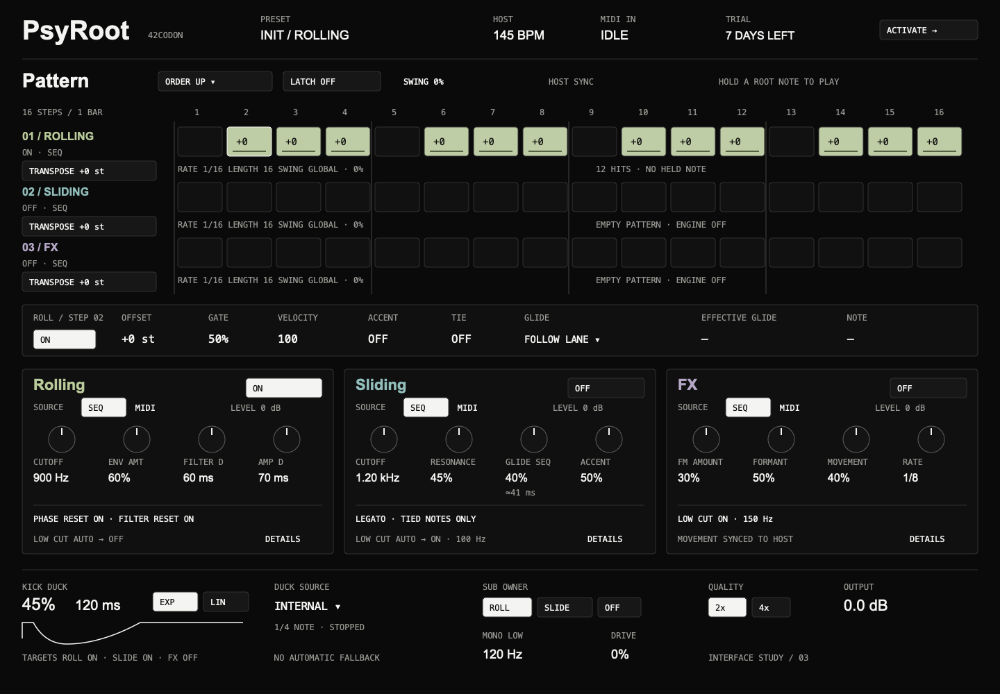

# PsyRoot interface

Owner: Astra. Design card approved by Linus on 2026-11-04. Study 03 is the implementation reference awaiting teammate review against architecture rev 0.1.5.

- [Interaction and state specification](INTERACTION_SPEC.md)
- [Editable SVG](psyroot-interface-v3.svg)
- [PNG preview](psyroot-interface-v3.png)

The static study shows INIT with transport stopped and no held MIDI note. It is not an implemented plugin. Controls use the architecture default table. Licensing flow screens and minimum-size verification remain open.

Run `python3 docs/ui/render.py` from the repo root to regenerate the SVG. It also creates a square SVG used only as a local Quick Look intermediate; do not commit that intermediate. The PNG was rendered locally with Quick Look at 1440 pixels and cropped to the first 1000 rows, then visually inspected.

Merge follows the project review workflow; design-card approval is not blanket approval for unresolved proposals.
